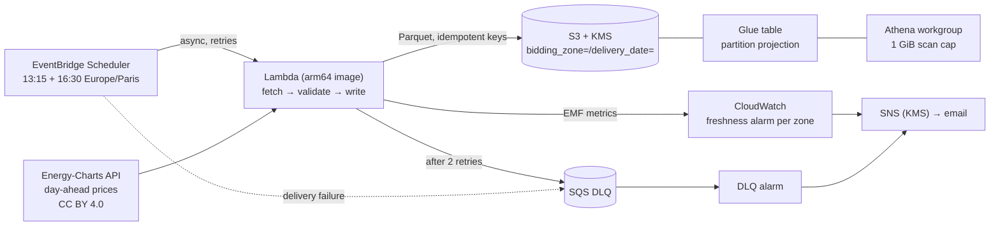

# Energy Market Ingestion

Serverless ingestion of **European day-ahead electricity prices**: the SDAC auction results, at 15-minute resolution, for France, Germany-Luxembourg, Belgium, the Netherlands and Spain. Prices are written to an **S3 Parquet data lake** and queried with **Athena**.

- **Runtime**: AWS Lambda (container image, arm64), EventBridge Scheduler, SQS DLQ.
- **Monitoring**: CloudWatch with embedded metrics.
- **Delivery**: Terraform and GitHub Actions through OIDC.

## Architecture



## Design choices

| Concern | Choice |
|---|---|
| **Correctness** | Each (zone, day) is validated before anything is written:<br/>- the interval count matches the local day length, so **92/96/100 quarter-hours on DST days** and 24 hours before the 2025-10-01 switch to 15-minute products;<br/>- every timestamp falls inside the delivery day, with no duplicates;<br/>- every price is present and within the SDAC limits [-500, 4000] €/MWh.<br/>Partial data is never stored. |
| **Idempotency** | Deterministic key `bidding_zone=XX/delivery_date=YYYY-MM-DD/prices.parquet`, so re-runs and backfills overwrite the same object. S3 versioning keeps the previous version. |
| **Late publication** | Two runs a day. "Not published yet" is reported but is not an error. A **freshness alarm per zone** fires after 30 h without data, even if every run succeeded. |
| **Failures** | Lambda retries asynchronous invocations twice, then sends the event to the SQS DLQ. Scheduler delivery failures go to the same DLQ. A DLQ alarm notifies, and `scripts/replay_dlq.py` replays the events once the cause is fixed. |
| **Source etiquette** | `reserved_concurrent_executions = 1`, a pause between calls, retries on 429/5xx that honor `Retry-After`. The API does rate-limit, as I found while building the fixtures. |
| **Observability** | **CloudWatch Embedded Metric Format**: metrics (intervals ingested, average price per zone) are emitted as log lines, with no API call and no SDK. X-Ray tracing is enabled. |
| **Security** | One KMS key for S3, SQS, SNS and Athena results, with explicit grants for CloudWatch and Scheduler. TLS-only bucket policy. IAM scoped to `s3:PutObject` on the data prefix. GitHub OIDC with no access keys, a deploy role trusted only from the protected `production` environment, and an explicit deny on editing itself. |
| **Supply chain** | Immutable image tag = commit SHA (Terraform rejects `latest`), immutable ECR tags, scan on push. Trivy runs on the image and the Terraform. Dependabot covers Actions, uv, Docker and Terraform. |
| **Cost** | Graviton, with about 1 minute of compute per day. Parquet with zstd compression and partition projection keep Athena scans tiny. Expect **well under $5/month** (mostly the KMS key). |

## Data

```sql
SELECT bidding_zone, delivery_start, price_eur_mwh
FROM market_ingest_prod_market.day_ahead_prices
WHERE bidding_zone = 'FR' AND delivery_date = DATE '2026-10-18'
ORDER BY delivery_start;
```

Saved queries ([sql/](sql/)) cover:
- daily baseload/min/max and negative-price intervals;
- the FR-DE spread;
- a rough daily **battery arbitrage** value: charge in the 2 cheapest hours, discharge in the 2 most expensive, at 88% round-trip efficiency.

| Column | Type | Notes |
|---|---|---|
| `delivery_start` / `delivery_end` | timestamp (UTC) | Delivery interval |
| `resolution_minutes` | smallint | 15 (since 2025-10-01) or 60 |
| `price_eur_mwh` | double | Clearing price |
| `source`, `ingested_at` | string, timestamp | Lineage |
| `bidding_zone`, `delivery_date` | partitions | Projected, no crawler |

## Tests

There are 32 pytest tests, all offline, built on **real API responses** captured as fixtures:
- a normal day;
- a 23-hour day (2026-03-29);
- a 25-hour day (2025-10-26);
- an hourly day with negative prices (2025-06-15);
- several zones.

They cover rate-limit retries, malformed payloads, validation, the Parquet round-trip, idempotent writes on moto S3, EMF output and the ops scripts. Four `terraform test` cases, against a mocked provider, check:
- the pinned image;
- the arm64 architecture;
- a concurrency of 1;
- schedules in Paris time;
- one freshness alarm per zone;
- that `latest` is rejected.

```bash
uv sync && uv run pytest
terraform -chdir=terraform init -backend=false && terraform -chdir=terraform test
```

> The tests caught two real bugs while I wrote this.
> 1. In Python, subtracting two datetimes that share the same `tzinfo` returns the *wall-clock* difference, so every day looked 24 h long.
> 2. A default argument (`fetch=energy_charts.fetch_day`) was bound when the function was defined, which silently bypassed a test double.

## Deploy

```bash
terraform -chdir=terraform/bootstrap init
terraform -chdir=terraform/bootstrap apply -var github_repository=<owner>/energy-market-ingestion
```

Then, in GitHub:
- add the variables `AWS_REGION`, `TF_STATE_BUCKET`, `AWS_DEPLOY_ROLE_ARN`;
- create an environment `production` with required reviewers.

Every merge to `main` then:
1. builds and pushes the arm64 image;
2. applies Terraform with that image tag;
3. runs a smoke invocation (it re-ingests today, which is idempotent).

Operations:

```bash
uv run python scripts/backfill.py --function market-ingest-prod --start 2025-10-01 --end 2026-10-17
uv run python scripts/replay_dlq.py --queue-url <dlq_url> --function market-ingest-prod --dry-run
```

## Status

Ingestion was run end to end locally against the live API (tomorrow's French auction, 96 intervals, written to S3 mocked with moto). The Terraform passes `validate` and `test`. **Not yet deployed to a real AWS account.**

## Data license

Prices from [Energy-Charts](https://energy-charts.info) (Fraunhofer ISE), sourced from Bundesnetzagentur | SMARD.de, under CC BY 4.0. Code under MIT.
